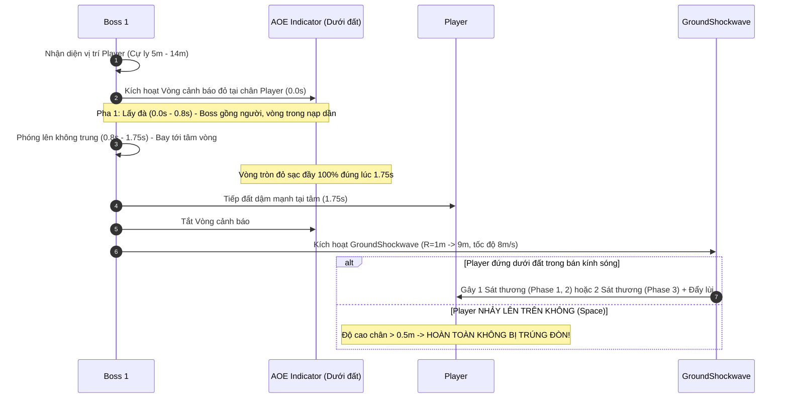

# Kế Hoạch Điều Chỉnh Boss 1 (Dị Thú Tha Hoá) - Boss Fix Plan (Cập Nhật Toàn Diện)

Tài liệu này tổng hợp toàn bộ các quyết định thiết kế và cơ chế đã thống nhất để chuẩn bị triển khai cho Boss 1:

---

## 1. Cơ Chế Mới: Khiên Lần 2 & Hồi Máu Lên 40% (Aura Đỏ)

- **Thời điểm kích hoạt**: Khi máu Boss lần đầu tụt xuống mốc $\le 20\%$ ($4 / 20\text{ HP}$).
- **Cơ chế Hồi máu**:
  - Boss khóa sát thương, bước vào state `BossBuff`.
  - Bật **Khiên Bất Hoại Cường Hóa (2 stacks)**.
  - **Hồi phục sinh lực lên 40% Max HP**: Máu được hồi phục từ $4\text{ HP} \rightarrow \mathbf{8\text{ HP}}$ ($8 / 20\text{ HP}$).
- **Thông báo & Chỉ thị**:
  - In thông báo hệ thống ra console log: `"[Boss1] Kích hoạt Khiên Bất Hoại Lần 2 & Hồi phục sinh lực lên 40% HP (Aura Đỏ)!"`.
  - Tạm thời chưa cần tạo hạt VFX/Aura đỏ phức tạp, giữ logic chuẩn xác cho gameplay.
- **Ý nghĩa trận đấu**:
  - Người chơi sau khi sống sót qua 10 giây sinh tồn và phản đòn 2 quả Cầu Lửa để phá nát Khiên sẽ có cơ hội xả combo dứt điểm **8 HP** còn lại (thay vì 4 HP).
  - Vì ở Phase này **I-Frames của Boss đã bị TẮT hoàn toàn ($0.0\text{s}$)**, việc đánh bại 8 HP sẽ diễn ra rất nhanh và đã tay thông qua các combo kiếm liên hoàn của Player!

---

## 2. Giải Thích Cơ Chế Đòn Jump Slam (Nhảy Vồ Dậm Đất)

Kỹ năng **Jump Slam** (`BossJumpSlam`) kết hợp giữa **va chạm trực tiếp tại tâm rơi** và **sóng chấn lan tỏa trên mặt sàn**:

- **Né tâm chấn**: Dash hoặc chạy ra khỏi vòng cảnh báo đỏ bán kính $3.5\text{m}$ trước khi Boss tiếp đất.
- **Né sóng chấn lan tỏa**: Sóng chấn quét sát mặt sàn (`hit_height = 0.5m`). Khi vành sóng quét tới, **người chơi chỉ cần bấm Nhảy (Space) lên không trung** là hoàn toàn không bị dính sát thương.

---

## 3. Thống Nhất Hướng Thiết Kế Đòn Đánh Thường (Hướng A)

- **Không tạo chỉ thị AOE cho đòn đánh thường cận chiến** (`Normal_Attack_1`, `Normal_Attack_2`).
- Đòn cào tay chỉ diễn ra ngay trước mặt Boss ở cự ly gần ($3.2\text{m}$). Boss đã có động tác giơ tay lấy đà tự nhiên ($0.7\text{s}$) làm tín hiệu thị giác (telegraph) cho người chơi né. Vòng tròn đỏ nạp đầy chỉ dành riêng cho kỹ năng diện rộng nguy hiểm **Jump Slam**.

---

## 4. Bảng Thông Số 3 Phase Của Trận Đấu

| Thông số / Thuộc tính | Phase 1 (100% -> 50%) | Phase 2 (Sau Bật Khiên 50%) | Phase 3 (Sau Bật Khiên 20% & Heal 40%) | Ghi chú thiết kế |
|---|---|---|---|---|
| **Máu khởi điểm Phase** | `20 HP` | `10 HP` | **`8 HP` (Đã hồi máu từ 4 HP lên 40%)** | Mốc máu chiến đấu |
| **Khiên Bất Hoại** | Không có | **1 Stack** (Bị vỡ bởi 1 quả cầu lửa) | **2 Stacks** (Cần phản 2 quả cầu lửa) | Cơ chế chính của Boss |
| **Tốc độ di chuyển (`walk_speed`)** | `3.2 m/s` | `4.2 m/s` (+31%) | `5.6 m/s` (+75%) | Boss áp sát nhanh và dồn dập |
| **Tốc độ Animation chiêu (`anim_speed`)** | `1.0x` | `1.2x` | `1.4x` | Vung tay và nhảy dậm nhanh hơn |
| **Thời gian nghỉ Idle (`_wait_timer`)** | `0.4s - 0.8s` | `0.2s - 0.5s` | `0.1s - 0.25s` | Boss hầu như không đứng yên |
| **Hồi chiêu Melee (`melee_cooldown`)** | `1.4s` | `0.9s` | `0.45s` | Cào liên tục khi player ở gần |
| **Hồi chiêu Jump Slam (`jump_slam_cooldown`)** | `5.0s` | `3.5s` | `2.2s` | Nhảy dậm liên tục ép player phải nhảy |
| **Hồi chiêu Cầu Lửa (`fireball_cooldown`)** | `3.5s` | `3.5s` | **`10.0s`** | **Giãn cách 10s theo đúng yêu cầu** |
| **Hệ số sát thương (`damage_multiplier`)** | `1x` (1 tim) | `1x` (1 tim) | **`2x` (2 tim - Gấp đôi)** | Đòn đánh cực kỳ chết người ở Phase cuối |
| **I-Frames của Boss** | `0.6s` | `0.6s` | **`0.0s` (Tắt hoàn toàn)** | Thưởng cho người chơi khi đã phá khiên |

---

## 5. Quy Trình Kỹ Thuật Triển Khai

1. **Scale Model**: Đặt `scale = (2.7, 2.7, 2.7)` cho `BossModel` trong `boss_1.tscn` để đạt chiều cao chuẩn 3.0m.
2. **AOE Indicator**: Tạo node/mesh chỉ thị vòng tròn đỏ phẳng nạp đầy trong $1.75\text{s}$ cho `JumpSlam`.
3. **Logic Hồi Máu Phase 3**: Trong `_on_hurtbox_hurt` của `boss_1.gd`, tại mốc 20%, gán `health.current_health = int(data.max_health * 0.40)` và in log thông báo `Aura Đỏ`.
4. **Nhân Đôi Sát Thương Phase 3**: Cập nhật `damage` cho Melee và Shockwave thành gấp đôi khi bước sang Phase 3.
5. **Cooldown Cầu Lửa 10 Giây**: Ở Phase 3, đặt `fireball_cooldown = 10.0s` trong `boss_data.gd`.
6. **Kiểm Thử Tự Động**: Cập nhật `tests/boss/test_boss_1.gd` để kiểm tra toàn bộ luồng: Khóa 50% $\rightarrow$ Phá khiên 1 $\rightarrow$ Khóa 20% & Heal 40% (8 HP) $\rightarrow$ Phản đòn 1 (khiên nứt) $\rightarrow$ Phản đòn 2 (khiên vỡ) $\rightarrow$ Dứt điểm 8 HP với 0.0s I-Frames.
